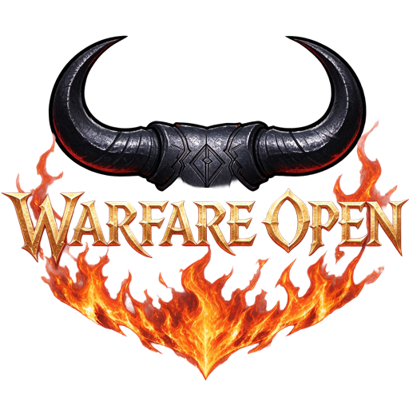
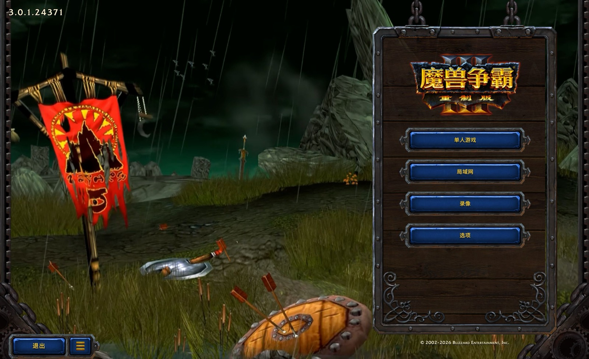
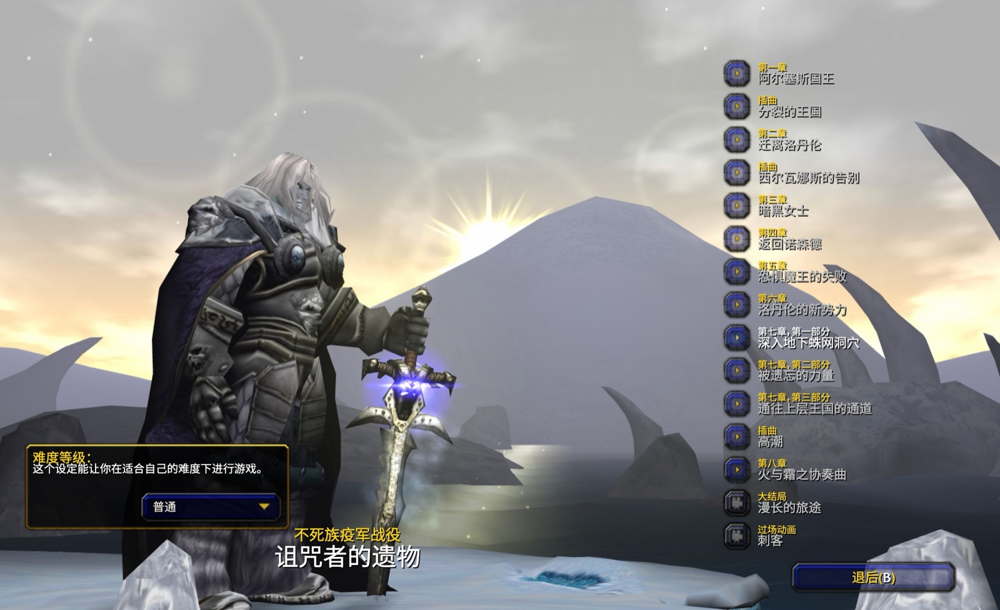
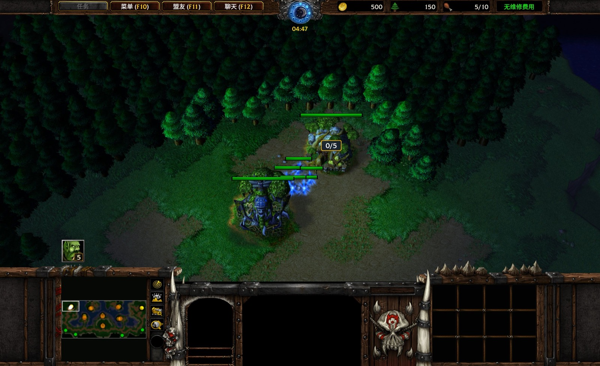
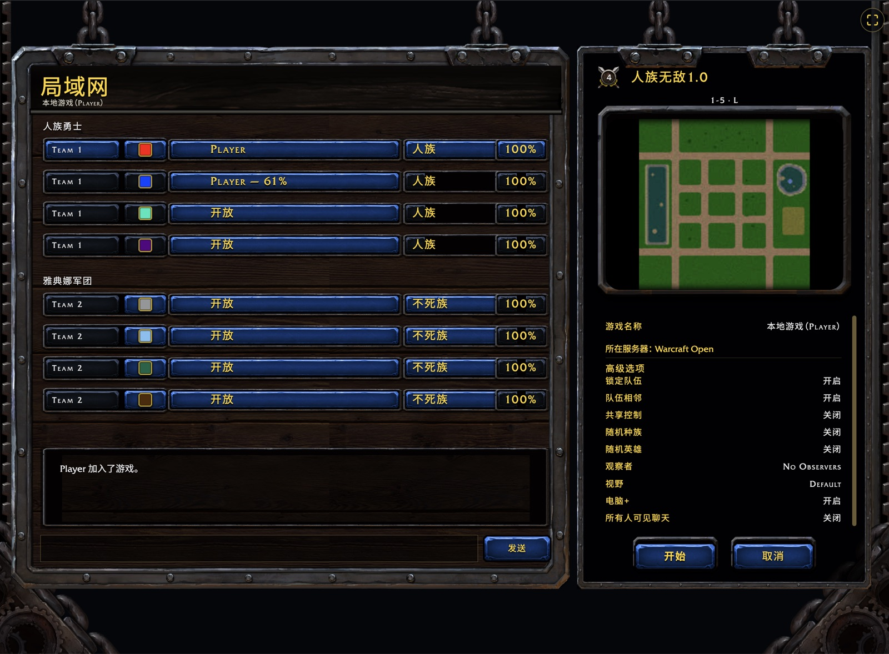

  

<h1 align="center">开放战争 · Warfare Open</h1>

  <strong>驱动《魔兽争霸 III》与《魔兽争霸 III：重制版》的开源游戏引擎</strong> 
  不是一款新游戏，而是让经典即时战略在现代平台上继续运行

  <a href="https://warcraft.hhkj.me/zh">官网</a> ·
  <a href="https://warcraft.hhkj.me/play/">网页版</a> ·
  <a href="https://warcraft.hhkj.me/zh/downloads">下载</a> ·
  <a href="https://warcraft.hhkj.me/zh/contact">反馈与联系</a>

---

> **本仓库目前只用于项目介绍、版本动态与下载指引，暂不包含源码。**
> 引擎源码会在准备完成后开放，敬请关注。

## 这是什么

**开放战争（Warfare Open）是一款开源游戏引擎，不是一款新游戏。**

它直接读取你电脑上的《魔兽争霸 III》或《魔兽争霸 III：重制版》游戏文件，用现代渲染与网络栈重新实现游戏运行时，把经典的战役、地图和对战体验带到 Windows、macOS、Linux、Android 以及浏览器。

你不需要重新购买游戏，也不需要把游戏文件上传到任何服务器——引擎只使用你本地已有的正版安装。

## 能做什么

| | |
|---|---|
| **经典版与重制版** | 同一套引擎读取两个版本的游戏文件，经典画面与高清模型都能运行。 |
| **局域网联机对战** | 不依赖战网，和朋友在同一个局域网里建房、对战。 |
| **战役与自定义地图** | 官方战役、自定义战役、经典对战与 RPG 地图都可以载入。 |
| **录像回放** | 回看对战录像，复盘操作与战术。 |
| **跨平台** | Windows、macOS、Linux、Android，以及免安装的网页版。 |
| **持续更新** | 桌面客户端内置更新；网页版刷新即是最新版本。 |

## 快速开始

1. 打开 [官网](https://warcraft.hhkj.me/zh) 下载客户端，或直接进入 [网页版](https://warcraft.hhkj.me/play/)。
2. 选择你已安装的《魔兽争霸 III》或《魔兽争霸 III：重制版》目录。
3. 开始战役、载入地图，或进入局域网房间与朋友对战。

- [下载桌面版 / Android 版](https://warcraft.hhkj.me/zh/downloads)
- [在浏览器中直接开玩](https://warcraft.hhkj.me/play/)

## 截图

<table>
  <tr>
    <td width="50%"></td>
    <td width="50%"></td>
  </tr>
  <tr>
    <td align="center">重制版主菜单</td>
    <td align="center">经典战役</td>
  </tr>
  <tr>
    <td width="50%"></td>
    <td width="50%"></td>
  </tr>
  <tr>
    <td align="center">游戏画面</td>
    <td align="center">局域网联机</td>
  </tr>
</table>

## 为什么做这个项目

《魔兽争霸 III》是很多人的 RTS 启蒙，但原版引擎在现代系统上越来越难用：高分辨率与宽屏支持有限、跨平台联机困难、重制版资源与经典版割裂。

开放战争希望解决这些问题：保留原版的操作手感与内容，用现代技术重做运行时，让老游戏在新设备上继续可玩、可联机、可分享。

## 合法使用

- 本项目**不附带、不分发任何暴雪游戏文件或素材**。
- 使用前需要自行拥有并安装正版《魔兽争霸 III》或《魔兽争霸 III：重制版》。
- Warcraft III 及相关商标、素材归 Blizzard Entertainment 所有。本项目与暴雪娱乐无隶属关系，也不代表其立场。

## 源码与后续

引擎源码尚未公开。后续会在这里发布：

- 源码开放计划
- 版本更新说明
- 贡献指南

在此之前，欢迎通过官网下载体验，并把问题与建议反馈给我们。

## English

**Warfare Open** is an open-source game engine (source coming soon) that runs *Warcraft III* and *Warcraft III: Reforged* from your own local game installation. It supports LAN multiplayer, campaigns, custom maps and replays, and runs on Windows, macOS, Linux, Android and the web.

- Website: <https://warcraft.hhkj.me>
- Play in browser: <https://warcraft.hhkj.me/play/>
- Downloads: <https://warcraft.hhkj.me/en/downloads>

No Blizzard game files are bundled or distributed. You must own a legitimate copy of Warcraft III or Warcraft III: Reforged. Warcraft III is a trademark of Blizzard Entertainment; this project is not affiliated with Blizzard.

---

© 2026 开放战争 · Warfare Open

